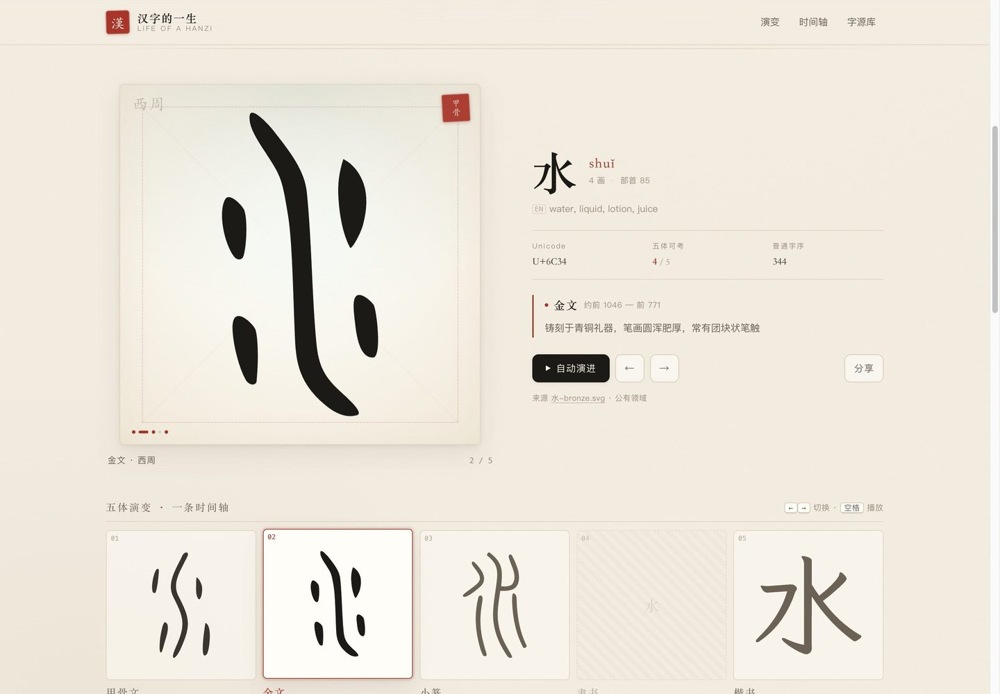

# 汉字的一生 · Life of a Hanzi

输入任意一个汉字，看它从 **甲骨文 → 金文 → 小篆 → 隶书 → 楷书** 的三千多年演变。
无后端、无框架、无跟踪，纯静态页面。

在线地址：<https://luoke-ai.github.io/hanzi-life/>



## 特性

- **任意汉字查询**：收录《通用规范汉字表》8105 字及其常见繁体、异体，共 9854 字，
  其中 4772 字有可考的古文字形，829 字可一路追溯到甲骨文。简体字自动借用其繁体字形（如「学」用「學」）。
- **五体时间轴**：五张字形卡片并排成一条时间轴，点击或按 `←` `→` 切换，
  空格键自动演进，逐体做「墨迹描画」动画。
- **纸墨视觉**：宣纸底、米字格、朱印、按时代变化的纸色（骨白 / 铜绿 / 石青 / 竹黄 / 素纸）。
- **深链分享**：`?z=日` 直接打开某字，点「分享」复制链接。
- **移动端适配**：时间轴横向滑动，字号与留白随视口收敛。

## 数据从哪来

| 内容 | 来源 | 许可 |
| --- | --- | --- |
| 甲骨文 / 金文 / 小篆 / 隶书字形 | [Wikimedia Commons · Ancient Chinese characters](https://commons.wikimedia.org/wiki/Category:Ancient_Chinese_characters) | 公有领域 / CC0 |
| 楷书（今文字）字形 | [霞鹜文楷 LXGW WenKai](https://github.com/lxgw/LxgwWenKai) 字体轮廓转曲 | SIL Open Font License 1.1 |
| 读音、笔画、部首、英文释义 | [Unicode Unihan 数据库](https://www.unicode.org/charts/unihan.html) | Unicode License |
| 简繁 / 异体映射 | Unihan `kSimplifiedVariant`、`kTraditionalVariant` | Unicode License |

古文字形来源为《说文解字》小篆、《殷周金文集成》等拓本摹写，各家释读或有出入，仅供观览。

## 技术实现

```
index.html            页面
assets/style.css      样式（纸纹、米字格、朱印、时代纸色）
assets/app.js         查字、时间轴、动画、深链
data/index.json       字表清单 + 五体元信息 + 有古文字的字（约 12 KB）
data/g/<0-511>.json   字形分片：按码位取模，一次只加载一个字所在的分片
scripts/              数据构建脚本（Commons 抓取、字体转曲、分片打包）
```

- 字形统一归一化到 `1000×1000` 画布、等比居中，路径坐标压缩到 1 位小数。
- 字形分片（512 片，单片 ≤ 150 KB，gzip 后约 40 KB）保证「查一个字只下一次小文件」。
- 描画动画用 `stroke-dasharray` + `fill-opacity` 双段关键帧；尊重 `prefers-reduced-motion`。

### 重新构建数据

```bash
python3 -m venv .venv && .venv/bin/pip install svgelements fonttools brotli
# 1) 从 Wikimedia Commons 下载并归一化古文字形（需联网，注意限流）
.venv/bin/python scripts/00_select.py   # 选字
.venv/bin/python scripts/01_fetch.py    # 下载 + 归一化
# 2) 从霞鹜文楷提取楷书轮廓（需自行下载 LXGWWenKai-Regular.ttf）
.venv/bin/python scripts/02_kai.py
# 3) 打包成分片
.venv/bin/python scripts/03_build.py
```

## 许可

- 页面代码：MIT
- 古文字形：公有领域（Wikimedia Commons）
- 楷书字形轮廓：SIL OFL 1.1，衍生自霞鹜文楷
- Unihan 数据：Unicode License
